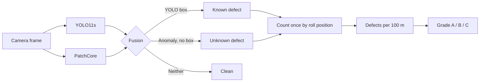
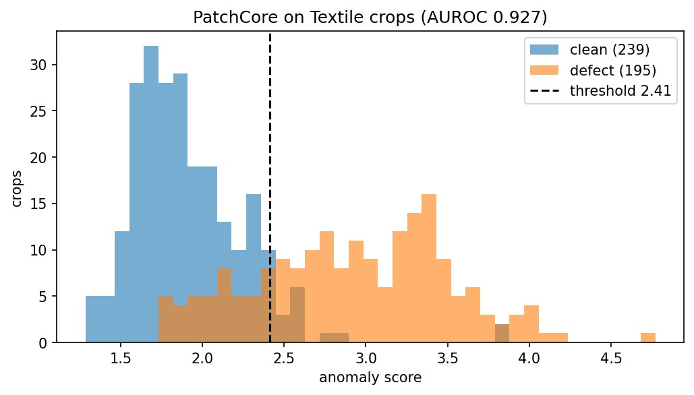
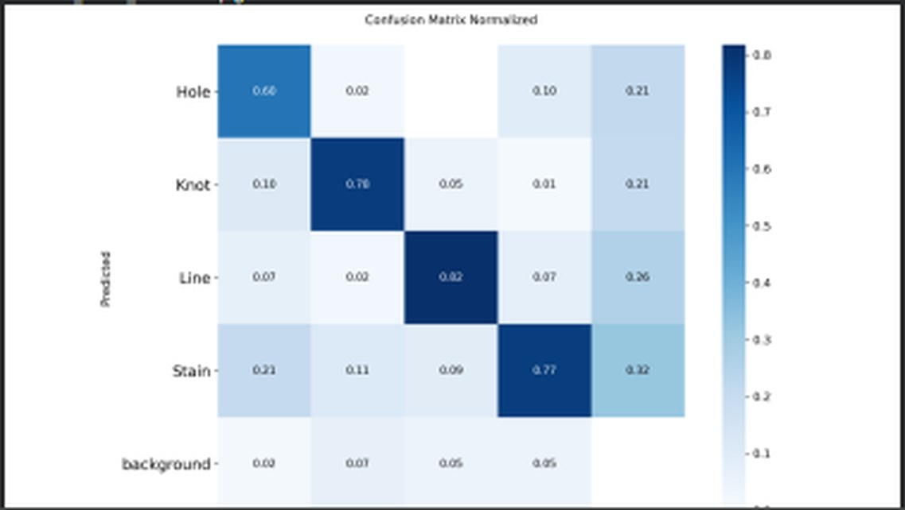
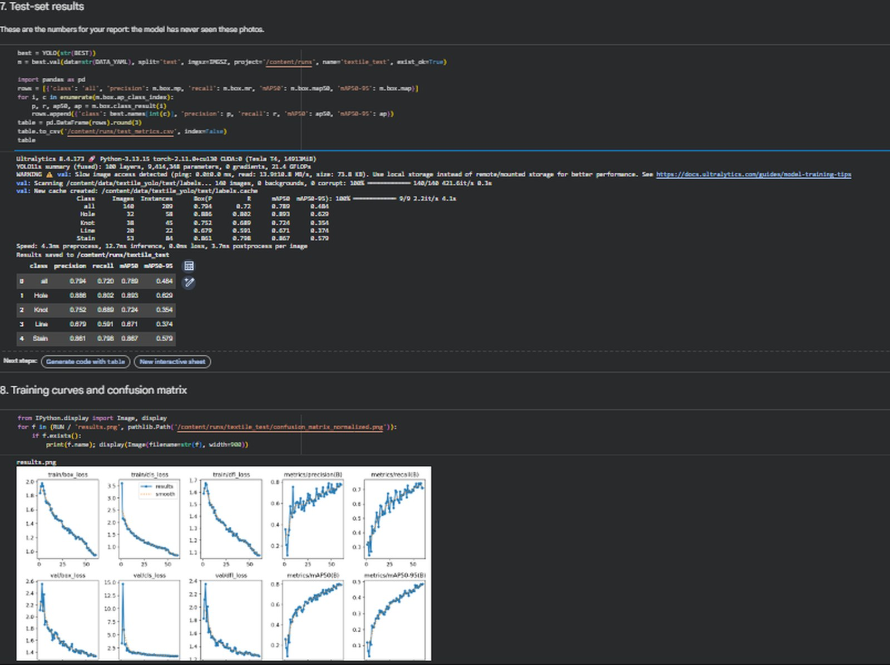

# Automated Textile and Fabric Defect Inspector


A system that finds, names and counts defects on fabric as the roll moves, then grades the roll.

NIAI AI/ML Batch 5 capstone by **Hammad Mehdi** and **Eisha Maqbool**.


*Output on test photos the models never saw. Coloured boxes are defects YOLO named, the heatmap is where PatchCore sees something unusual.*

## Contents

- [How it works](#how-it-works)
- [Results](#results)
- [Screenshots](#screenshots)
- [Run the dashboard](#run-the-dashboard)
- [Reproduce the training](#reproduce-the-training)
- [Repo layout](#repo-layout)
- [Known gaps](#known-gaps)
- [Data](#data)

## How it works

Two models look at every frame.

- **YOLO11s** detects the four defects it was trained on: Hole, Knot, Line and Stain.
- **PatchCore** only ever sees clean fabric during training. Anything that looks different from clean fabric gets a high anomaly score, so it can flag defects YOLO has never seen.

A fusion step then decides what each region is, counts each defect once, and grades the roll.



Fusion rules:

| YOLO box | PatchCore anomaly | Result |
|---|---|---|
| Yes | Any | Known defect, with class name |
| No | Yes (4 or more cells above threshold) | Unknown defect |
| No | No | Clean |

Counting: a defect is tracked by its position on the roll, so it is counted once even though it appears in many frames. It has to be seen in at least 2 frames to count.

Grading, in defects per 100 m: **A** up to 5, **B** up to 15, **C** above 15.

## Results

All numbers are on test photos held out by original photo, so augmented copies of a training photo never leak into the test set.

| What | Result | Target |
|---|---|---|
| YOLO, test mAP50 | 0.789 | met |
| PatchCore, AUROC | 0.927 | met |
| Fusion, defects found on 140 unseen photos | 93.3% | |
| Fusion, false alarms per photo | 0.12 | |
| Simulated 6 m roll, defects counted | 53 of 67 | not met (within 10%) |
| Speed on a Colab T4 | about 1.6 fps | not met (5 fps) |

YOLO per class (mAP50): Hole 0.893, Stain 0.867, Knot 0.724, Line 0.671.

**Hidden-class test.** To check that PatchCore really catches defects YOLO does not know, we hid one class from YOLO at a time and measured how many of those defects were still found:

| Hidden class | Still found |
|---|---|
| Hole | 89.7% |
| Stain | 44.0% |
| Knot | 8.9% |
| Line | 4.5% |

So the "unknown defect" path works well for large, high-contrast defects and poorly for thin or tiny ones.

## Screenshots

**Simulated roll with running count**


**PatchCore anomaly heatmaps**


**PatchCore scores, clean vs defect crops**



**YOLO confusion matrix**



**YOLO training curves**



## Run the dashboard

```
git lfs install
git clone https://github.com/hammadmehdi72/Fabric-Defect.git
cd Fabric-Defect/dashboard
pip install -r requirements.txt
streamlit run app.py
```

The browser opens at `http://localhost:8501`. From there you can run a simulated roll built from test photos or upload your own video, and download the annotated video and the defect log.

The dashboard needs the two model files that are already in `dashboard/`: the YOLO weights (`best*.pt`) and `patchcore_textile.pt`. The PatchCore file is 170 MB and is stored with Git LFS, which is why `git lfs install` comes first.

## Reproduce the training

1. **Prepare the data**

   ```
   pip install opencv-python numpy pyyaml
   python prepare_data.py --textile Textile.yolov11 --coco "fabric defect.coco" --out prepared
   ```

2. **Train YOLO**: open `train_yolo_textile.ipynb` in Colab (T4 GPU), or run `python train_yolo_local.py` on a local GPU.
3. **Train PatchCore**: open `train_patchcore_textile.ipynb` in Colab.
4. **Fusion, counting and grading**: open `fusion_inspector_v2.ipynb` in Colab.

## Repo layout

| Path | What it is |
|---|---|
| `prepare_data.py` | Splits the datasets by original photo and makes the PatchCore crops |
| `train_yolo_textile.ipynb`, `train_yolo_local.py` | YOLO training |
| `train_patchcore_textile.ipynb` | PatchCore training |
| `fusion_inspector.ipynb`, `fusion_inspector_v2.ipynb` | Fusion, counting and grading |
| `make_video_from_dataset.py` | Builds simulated roll videos from dataset photos |
| `dashboard/` | Streamlit app and the two trained models |
| `Textile.yolov11/`, `fabric defect.coco/` | Datasets as exported from Roboflow |
| `prepared/` | Output of `prepare_data.py` |
| `videos/` | 51 simulated roll videos with ground-truth CSVs |
| `fabric inspector fusion/`, `fabric inspector pathcore/` | Result files from the Colab runs |
| `docs/images/` | Screenshots used in this README |
| `Fabric_Defect_Inspector_Report.pdf` | Full project report |

## Known gaps

- Nothing has been tested on real fabric video yet. The roll videos are made by joining dataset photos.
- The count on the simulated roll is about 21% under (53 of 67).
- The Line class is the weakest for both models.
- Speed is about 1.6 fps on a T4, below the 5 fps target.

## Data

Both datasets come from Roboflow Universe and keep their original licences. Check those licences before reusing the images.

## Authors

Hammad Mehdi and Eisha Maqbool, NIAI AI/ML Batch 5.
