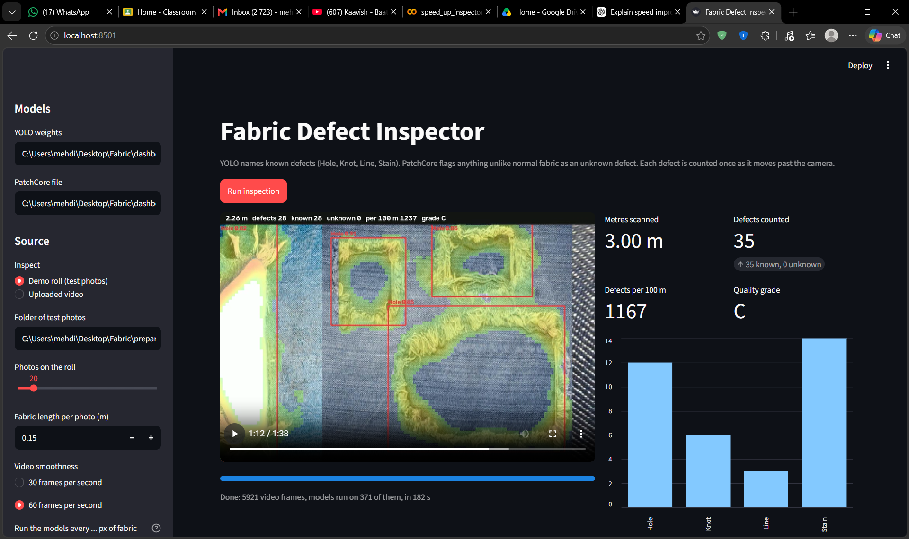
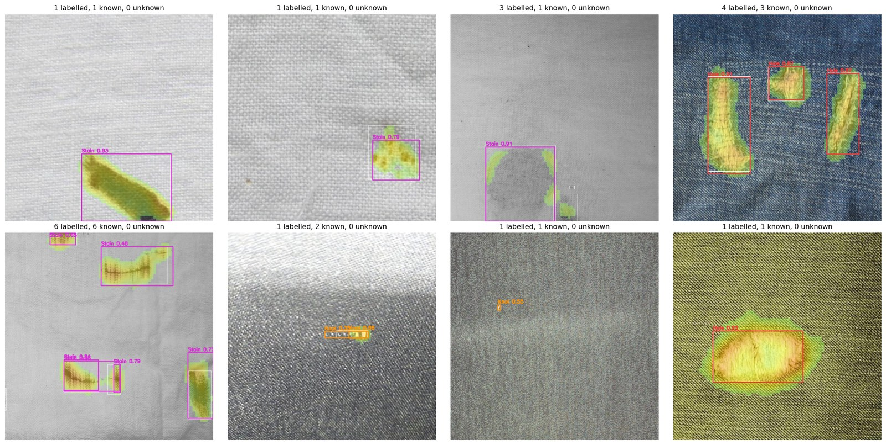
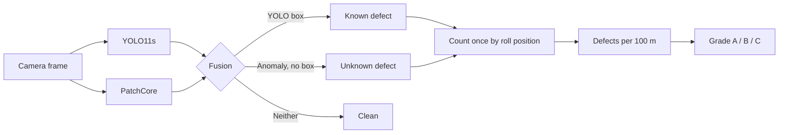
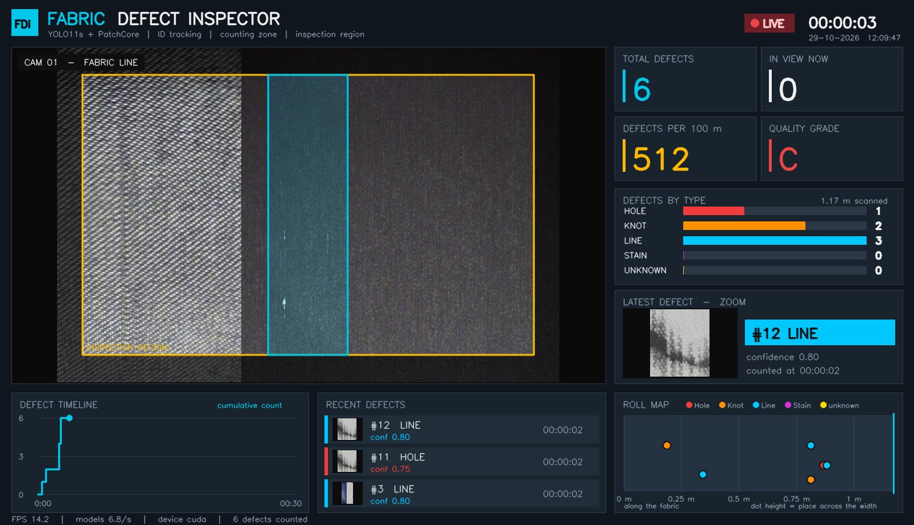
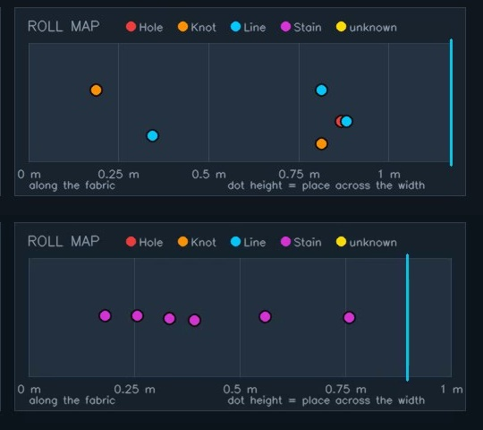
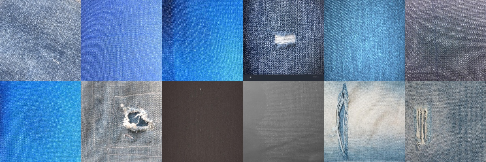
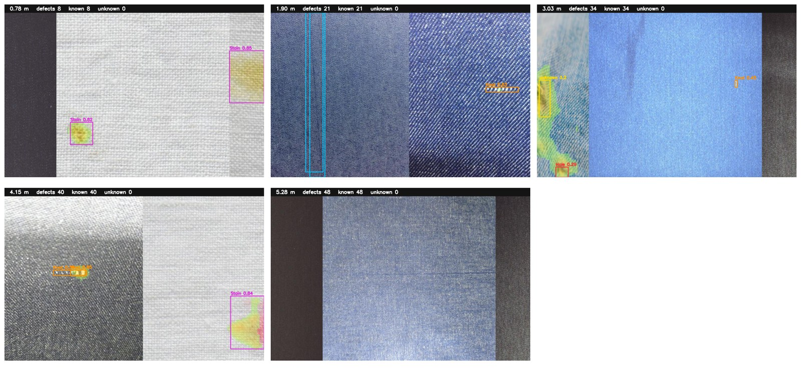
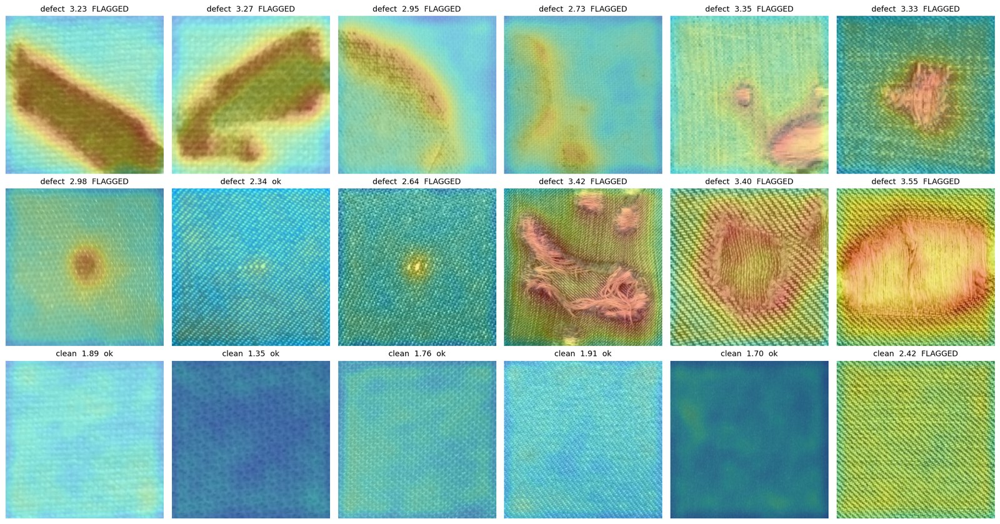
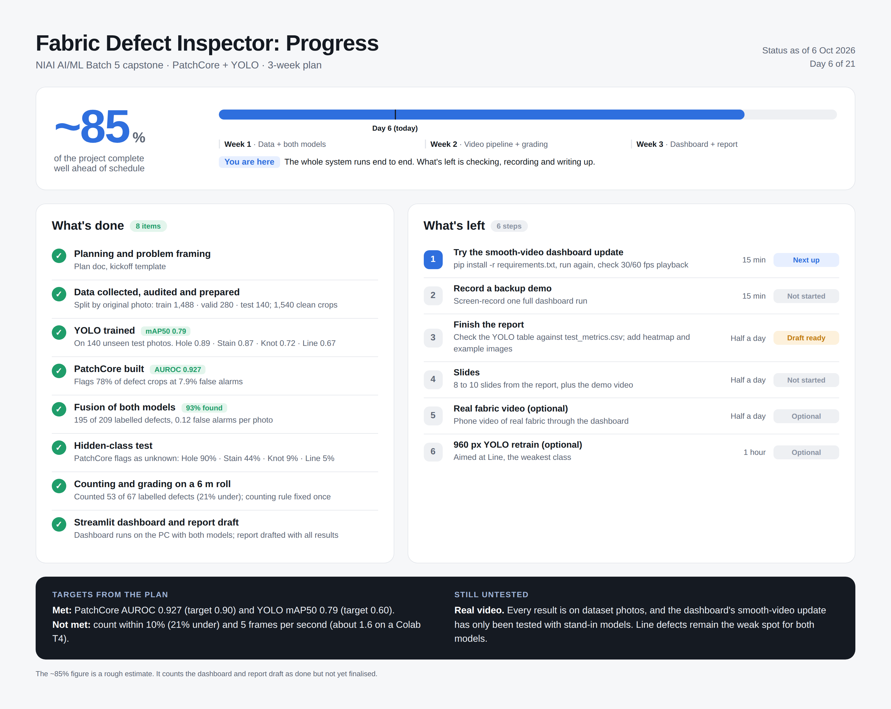

# Automated Textile and Fabric Defect Inspector


A system that finds, names and counts defects on fabric as the roll moves, then grades the roll.

NIAI AI/ML Batch 5 capstone by **Hammad Mehdi** and **Eisha Maqbool**.



*The dashboard after a 3 m demo roll built from test photos: annotated video, running count, defects per 100 m and grade.*



*Output on test photos the models never saw. Coloured boxes are defects YOLO named, the heatmap is where PatchCore sees something unusual.*

## Contents

- [How it works](#how-it-works)
- [Results](#results)
- [Dashboard](#dashboard)
- [Screenshots](#screenshots)
- [Run the dashboard](#run-the-dashboard)
- [Reproduce the training](#reproduce-the-training)
- [Repo layout](#repo-layout)
- [Known gaps](#known-gaps)
- [Data](#data)

## How it works

Two models look at every frame.

- **YOLO11s** detects the four defects it was trained on: Hole, Knot, Line and Stain.
- **PatchCore** only ever sees clean fabric during training. Anything that looks different from clean fabric gets a high anomaly score, so it can flag defects YOLO has never seen.

A fusion step then decides what each region is, counts each defect once, and grades the roll.



Fusion rules:

| YOLO box | PatchCore anomaly | Result |
|---|---|---|
| Yes | Any | Known defect, with class name |
| No | Yes (4 or more cells above threshold) | Unknown defect |
| No | No | Clean |

Counting: a defect is tracked by its position on the roll, so it is counted once even though it appears in many frames. It has to be seen in at least 2 frames to count.

Grading, in defects per 100 m: **A** up to 5, **B** up to 15, **C** above 15.

## Results

All numbers are on test photos held out by original photo, so augmented copies of a training photo never leak into the test set.

| What | Result | Target |
|---|---|---|
| YOLO, test mAP50 | 0.789 | met |
| PatchCore, AUROC | 0.927 | met |
| Fusion, defects found on 140 unseen photos | 93.3% | |
| Fusion, false alarms per photo | 0.12 | |
| Simulated 6 m roll, defects counted | 53 of 67 | not met (within 10%) |
| Speed on a Colab T4, both models on every frame | 15.6 fps (was 1.7) | met (5 fps) |

**Speed-up.** PatchCore was the slow part (582 ms of every 600 ms frame). Keeping a 5% coreset of its memory bank (2,772 of 55,440 patches) and running it in half precision cut that to 48 ms. On the same roll the count stayed at 53 of 67. On the test photos, defects found went from 93.3% to 92.3% and false alarms from 0.12 to 0.13 per photo. See `speed_up_inspector.ipynb`.

YOLO per class (mAP50): Hole 0.893, Stain 0.867, Knot 0.724, Line 0.671.

**Why the count misses the target.** A second roll built from validation photos was counted 12% over, while the test roll was 21% under, so no single threshold fixes both. Of the 13 defects missed on the test roll, 6 were seen by YOLO below the 0.25 confidence cut, 4 were lost in counting, 2 were not seen at all and 1 was removed by the photo-join filter. Retraining YOLO at 960 px did not help (test mAP50 0.750 against 0.789), so the 640 px model is kept. See `count_diagnosis.ipynb` and `retrain_yolo_960.ipynb`.

**Hidden-class test.** To check that PatchCore really catches defects YOLO does not know, we hid one class from YOLO at a time and measured how many of those defects were still found:

| Hidden class | Still found |
|---|---|
| Hole | 89.7% |
| Stain | 44.0% |
| Knot | 8.9% |
| Line | 4.5% |

So the "unknown defect" path works well for large, high-contrast defects and poorly for thin or tiny ones.

## Dashboard

The Streamlit dashboard has three sources: a **demo roll** built from test photos, an **uploaded video**, and a **live camera**. All three can show a control-room view:



*Layout of the control-room view, shown here with a test detector on a recorded roll, so the boxes are not real detections.*

| Part of the screen | What it shows |
|---|---|
| Camera view | Defects with their ID, type and confidence |
| Tiles | Total defects, defects in view now, defects per 100 m, quality grade |
| Defects by type | Count per class: Hole, Knot, Line, Stain, unknown |
| Latest defect | Close-up of the last defect counted |
| Recent defects | The last three, with thumbnails and times |
| Defect timeline | Running total over time |
| Roll map | Each defect at its place along the fabric (metres) and across its width |



*Roll map. Dots lined up at one height point to a defect repeating at the same place across the width, often one faulty part of the machine.*

**Live camera mode**, for a camera fixed above moving fabric:

- **Counting zone:** a band across the view. Each defect gets an ID and is counted once when it passes through.
- **Inspection region:** only this part of the view is inspected, so the table, hands or room around the cloth are ignored.
- **Learn this fabric:** with clean cloth in view, the dashboard captures 40 frames, builds a new PatchCore memory for that fabric and camera, sets its own alarm level and saves it as `patchcore_my_fabric.pt`. No labelling needed.
- **Save frame for labelling:** saves camera frames to `captured_frames/`, to label in Roboflow and retrain YOLO on your own camera.
- **Fabric check:** if a large share of the view looks unusual, the camera is probably not on fabric the models know, so nothing is counted.

The demo roll and uploaded video keep the original roll-position counting, so the results above still apply to them. The saved video records the full control-room screen.

## Screenshots

**Dataset samples**



*Photos from the Textile dataset: clean fabric and defects such as holes and knots.*

**Simulated roll with running count**



**PatchCore anomaly heatmaps**



**PatchCore scores, clean vs defect crops**


**YOLO confusion matrix**


**YOLO training curves**


**Project progress**



## Run the dashboard

```
git lfs install
git clone https://github.com/hammadmehdi72/Fabric-Defect.git
cd Fabric-Defect/dashboard
pip install -r requirements.txt
streamlit run app.py
```

The browser opens at `http://localhost:8501`. Pick a source in the sidebar: a demo roll built from test photos, your own video, or a live camera connected to the computer running Streamlit. See [Dashboard](#dashboard) for what each part of the screen shows. For live camera, fix the camera above the fabric with bright, even light, and press "Learn this fabric" with clean cloth in view before inspecting.

The dashboard needs the two model files that are already in `dashboard/`: the YOLO weights (`best*.pt`) and a PatchCore file. If `patchcore_textile_fast.pt` (17 MB) is there it is used; otherwise the original `patchcore_textile.pt`, which is 170 MB and is stored with Git LFS, which is why `git lfs install` comes first.

## Reproduce the training

1. **Prepare the data**

   ```
   pip install opencv-python numpy pyyaml
   python prepare_data.py --textile Textile.yolov11 --coco "fabric defect.coco" --out prepared
   ```

2. **Train YOLO**: open `train_yolo_textile.ipynb` in Colab (T4 GPU), or run `python train_yolo_local.py` on a local GPU.
3. **Train PatchCore**: open `train_patchcore_textile.ipynb` in Colab.
4. **Fusion, counting and grading**: open `fusion_inspector_v2.ipynb` in Colab.

## Repo layout

| Path | What it is |
|---|---|
| `prepare_data.py` | Splits the datasets by original photo and makes the PatchCore crops |
| `train_yolo_textile.ipynb`, `train_yolo_local.py` | YOLO training |
| `train_patchcore_textile.ipynb` | PatchCore training |
| `fusion_inspector.ipynb`, `fusion_inspector_v2.ipynb` | Fusion, counting and grading |
| `speed_up_inspector.ipynb` | Speed-up: smaller PatchCore bank and half precision |
| `count_diagnosis.ipynb` | Finds why defects are missed on the roll and tries fixes |
| `retrain_yolo_960.ipynb` | Retrains YOLO at higher resolution and checks its defect counts |
| `make_video_from_dataset.py` | Builds simulated roll videos from dataset photos |
| `dashboard/app.py` | The dashboard screen, settings, inspection run and downloads |
| `dashboard/inspector.py` | Runs the models, tracks defects by roll position, counts them and grades the roll; learns a new fabric |
| `dashboard/live.py` | Live camera: ID tracking, counting zone, inspection region, models in a background thread |
| `dashboard/hud.py` | Draws the control-room view and the roll map |
| `dashboard/patchcore_my_fabric.pt` | PatchCore memory learned from the live camera with "Learn this fabric" |
| `dashboard/requirements.txt` | Python packages needed to run the dashboard |
| `dashboard/patchcore_textile_fast.pt` | Smaller, faster PatchCore model weights |
| `Textile.yolov11/`, `fabric defect.coco/` | Datasets as exported from Roboflow |
| `prepared/` | Output of `prepare_data.py` |
| `videos/` | 51 simulated roll videos with ground-truth CSVs |
| `fabric inspector fusion/`, `fabric inspector pathcore/` | Result files from the Colab runs |
| `docs/images/` | Screenshots used in this README |
| `Fabric_Defect_Inspector_Report.pdf` | Full project report |
| `Fabric_Defect_Inspector_Proposal.pptx` | Proposal presentation, with the speaking script in the slide notes |
| `fabric_inspector_speed-*/`, `fabric_inspector_count-*/`, `fabric_inspector_yolo960-*/` | Result tables (and model files) from the speed-up, count diagnosis and 960 px runs |

## Known gaps

- The reported results come from dataset photos and simulated rolls made by joining them. Live camera mode works, but its accuracy on real fabric has not been measured yet.
- The count on the simulated roll is about 21% under (53 of 67).
- The Line class is the weakest for both models.
- PatchCore only knows the fabric it was shown. On a different fabric it flags large areas as unknown until it is given clean samples of that fabric.

## Data

Both datasets come from Roboflow Universe and keep their original licences. Check those licences before reusing the images.

## Authors

Hammad Mehdi and Eisha Maqbool, NIAI AI/ML Batch 5.
